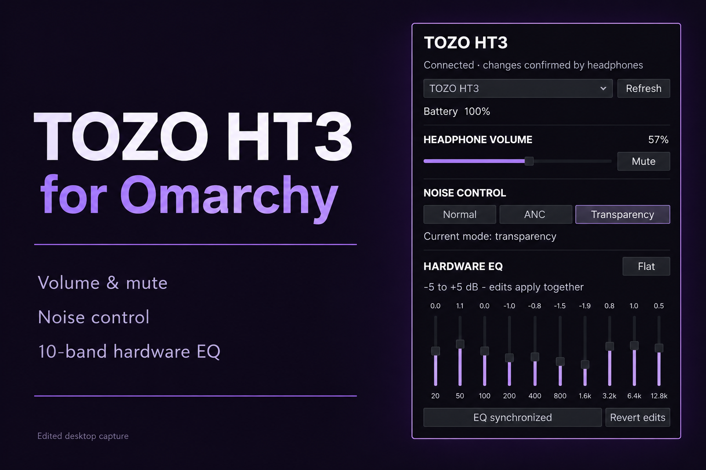
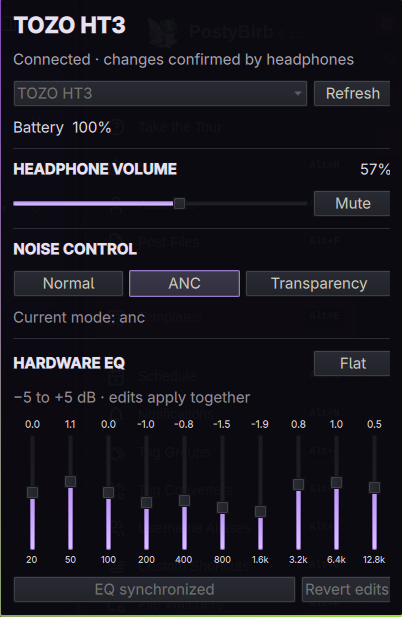

# TOZO HT3 for Omarchy


[SUBCULT](https://subcult.tv) · [Support on Patreon](https://patreon.com/subcult)

A top-bar widget for [Omarchy](https://github.com/basecamp/omarchy) that controls TOZO HT3 headphones from a popup: volume, noise mode and the headset's ten-band hardware EQ. It is for people who own an HT3 and use Omarchy, and would rather not open the phone app to switch to ANC.

This is an early release (version 0.1.0). It was written against one tested HT3 and talks to the headset over a protocol worked out independently (see [PROTOCOL.md](PROTOCOL.md)); other TOZO models and firmware versions are not supported.



The preview above is an edited desktop capture with a title and background added. The close-up below is an unretouched capture of the popup with ANC selected; the battery, volume, mode and EQ values are examples, not defaults. The popup follows the active Omarchy theme.



## Features

- Playback volume and mute for the HT3 output through PipeWire. The slider changes only the HT3, even when another device is the default output.
- Normal, ANC and transparency modes. A mode button lights up only after the headset reports the new mode back.
- Ten-band hardware EQ from -5 to +5 dB with Apply, Flat and Revert. Slider changes stay a draft until you press Apply, and the plugin checks that the headset confirms the new curve.
- Battery level, plus disconnected and error states.
- Automatic connection when one HT3 is paired; a device picker when there are several.
- Keyboard-accessible controls.
- Closing the popup releases the control connection without disconnecting Bluetooth audio. A per-device lock stops popups on two monitors from sending competing commands.

## Quick start

Requirements:

- Omarchy 4.0.4 or newer with Quickshell.
- BlueZ (`bluetoothctl`), PipeWire and `/usr/bin/python3`.
- An HT3 already paired through the normal Bluetooth settings.

No pip packages, elevated privileges, GTK window, network access or system service are needed.

Install and enable the plugin:

```bash
omarchy plugin add https://github.com/subculture-collective/omarchy-plugin-ht3.git --enable
```

The installer clones and validates the repository and adds the widget to the right side of the current bar without replacing the bar. If the plugin is installed but disabled:

```bash
omarchy plugin enable patrickfanella.ht3 right
```

Click the headphone icon to open the popup.

- Unapplied EQ edits, including Flat, are discarded when you close the popup.
- Turn off spatial audio in the TOZO phone app before using the hardware EQ.
- If the phone app is holding the control channel, close the app and reopen the popup.
- If Bluetooth audio is disconnected, reconnect it from Omarchy's Bluetooth menu.

Disable or remove the plugin:

```bash
omarchy plugin disable patrickfanella.ht3
omarchy plugin remove patrickfanella.ht3 --yes
```

The plugin stores no settings, credentials or files outside its installation directory. Its per-device lock lives in your user runtime directory only while the popup is open.

## How it works

- `bluetoothctl` lists paired devices. The bundled helper, `bridge.py`, opens a Bluetooth Classic RFCOMM connection only to the selected paired device whose name identifies it as a TOZO HT3.
- `bridge.py` uses only the Python standard library. The widget sends it one JSON request per line (`devices`, `connect`, `refresh`, `mode`, `eq`, `disconnect`) and reads one JSON response per line.
- Quickshell's PipeWire API finds the HT3 output by Bluetooth address and changes only that output's volume and mute state.

[PROTOCOL.md](PROTOCOL.md) documents the frame format and commands, and where the protocol facts came from.

## Project layout

| Path | Contents |
| --- | --- |
| `manifest.json` | Plugin ID and bar widget entry. |
| `Widget.qml` | Bar icon and popup. |
| `bridge.py` | RFCOMM helper for battery, noise mode and EQ. |
| `tests/test_bridge.py` | Helper tests. |
| `mise.toml` | The `test` task. |

## Contributing

Report bugs and request features in [GitHub issues](https://github.com/subculture-collective/omarchy-plugin-ht3/issues). Send code as pull requests on GitHub against `main`. CI runs the helper tests, compiles the helper, validates the plugin and lints the QML against Omarchy 4.0.4 on every pull request. On an Omarchy system, run the same checks with:

```bash
mise run test
```

## License

[MIT](LICENSE). Copyright Patrick Fanella. Made as part of [SUBCULT](https://subcult.tv).
